# Tarefa: mover o display OLED do ATmega328P para o ESP32-S3

| Campo | Valor |
|---|---|
| Status | Concluída |
| Versão | 8 |
| Branch | `feature/esp32-display` |

O ATmega328P passa a cuidar só da aquisição (sensor + SPI). O ESP32-S3, que já recebe as amostras e publica no MQTT, passa a exibir a temperatura.

## Histórico

| Versão | Data | Mudança |
|---|---|---|
| 1 | 2026-11-14 | Fluxograma e checklist iniciais |
| 2 | 2026-11-14 | Passos 0 e 1 concluídos; a pasta foi renomeada para `DataCom` em vez de `comunicacao-de-dados` |
| 3 | 2026-11-14 | Decisões do passo 2: I2C em GPIO8/GPIO9; tela só com a temperatura, redesenhada a cada 1 s; `--.-` até a primeira amostra. O driver passa a se chamar `TemperatureDisplay` |
| 4 | 2026-11-14 | Passos 3 e 4 concluídos e builds passando; passo 5 com docs e esquemático atualizados, PDF pendente (arquivo bloqueado). Decisão extra: sem display, o ESP32 segue funcionando e só registra o erro |
| 5 | 2026-11-14 | Passo 5 concluído: PDF exportado. Gerador do esquemático versionado em `tools/generate_schematic.py`. Entram no commit: a renomeação `docs/atmega-pinout.pdf` → `docs/atmega328-pinout.pdf` e `docs/esp32s3-pinout.bmp` |
| 6 | 2026-11-14 | Passo 6: firmwares gravados e link SPI validado no hardware (seq 1 e 2 recebidas pelo ESP32). Falha inicial: todos os fios do lado do ESP32 estavam um pino deslocados no conector; achado com firmwares de diagnóstico (teste pino a pino e busca I2C). Teste MQTT fica para depois |
| 7 | 2026-11-14 | Escopo ampliado: contagem regressiva até a próxima amostra na tela (`samplePeriodMs` movido para `common/protocol.h`) e LED RGB da placa apagado no boot |
| 8 | 2026-11-15 | Concluída: display confirmado no hardware (temperatura e contador). O teste do broker MQTT passa para a próxima tarefa |

## Fluxograma

```mermaid
flowchart TD
    start(["Início"])

    subgraph S0["0. Fechar a tarefa anterior (SPI + MQTT)"]
        s01["0.1 Renomear a pasta<br/>comunicação de dados → DataCom"]
        s02["0.2 pio run -e uno<br/>pio run -e esp32s3"]
        s03["0.3 Commit na feature/spi-mqtt-gateway<br/>e merge na develop"]
        s01 --> s02
    end

    start --> s01
    s02 --> d0{"Os dois builds<br/>passaram?"}
    d0 -- não --> fix0["Corrigir o erro"] --> s02
    d0 -- sim --> s03

    s03 --> s1["1. git checkout develop<br/>git checkout -b feature/esp32-display"]

    subgraph S2["2. Decisões antes de codar"]
        s21["2.1 Pinos I2C no ESP32-S3<br/>GPIO8 SDA / GPIO9 SCL<br/>⚠ muda a pinagem: registrar"]
        s22["2.2 Conteúdo da tela<br/>só a temperatura<br/>--.- até a primeira amostra"]
        s23["2.3 Ritmo<br/>tela redesenhada a cada 1 s<br/>valor muda a cada amostra (30 s)"]
        s21 --> s22 --> s23
    end

    s1 --> s21

    subgraph S3["3. ATmega328P: remover o display"]
        s31["3.1 Apagar drivers/TemperatureDisplay"]
        s32["3.2 TemperatureMonitor: tirar display,<br/>refresh_display, displayIntervalMs e halt"]
        s33["3.3 main.cpp: tirar constantes e instância do OLED"]
        s34["3.4 platformio.ini: remover Adafruit SSD1306 e GFX"]
        s35["3.5 pio run -e uno<br/>RAM deve cair ~1 KB em execução"]
        s31 --> s32 --> s33 --> s34 --> s35
    end

    s23 --> s31

    subgraph S4["4. ESP32-S3: implementar o display"]
        s41["4.1 platformio.ini: adicionar Adafruit SSD1306 e GFX"]
        s42["4.2 drivers/TemperatureDisplay<br/>begin, show_temperature, show_waiting"]
        s43["4.3 GatewayApp: redesenhar a tela a cada 1 s<br/>com a última temperatura recebida"]
        s44["4.4 main.cpp: pinos I2C, endereço 0x3C, instância"]
        s45["4.5 pio run -e esp32s3"]
        s46["4.6 Contagem regressiva até a próxima amostra<br/>samplePeriodMs em common/protocol.h"]
        s47["4.7 Apagar o LED RGB da placa no boot"]
        s41 --> s42 --> s43 --> s44 --> s45 --> s46 --> s47
    end

    s35 --> s41

    subgraph S5["5. Documentação"]
        s51["5.1 docs/ligacoes.md<br/>OLED sai do Uno e vai para o ESP32 (3,3 V)"]
        s52["5.2 Esquemático KiCad<br/>mover o OLED, ERC e PDF"]
        s53["5.3 docs/protocolo_spi.md<br/>sem mudança"]
        s51 --> s52 --> s53
    end

    s47 --> s51

    subgraph S6["6. Teste no hardware"]
        s61["6.1 Religar o OLED no ESP32<br/>VCC 3V3, GND, SDA, SCL"]
        s62["6.2 /upload-firmware uno<br/>/upload-firmware esp32s3"]
        s63["6.3 Monitor serial do ESP32<br/>amostra recebida e MQTT publicado"]
        s61 --> s62 --> s63
    end

    s53 --> s61
    s63 --> d6{"A tela mostra<br/>a temperatura?"}
    d6 -- não --> diag["Diagnóstico<br/>SSD1306 not found → fios e endereço 0x3C/0x3D<br/>invalid SPI frame → problema no SPI, não no display"]
    diag --> s62

    subgraph S7["7. Fechar"]
        s71["7.1 pio run -e uno<br/>pio run -e esp32s3"]
        s72["7.2 Commit<br/>feat: move OLED display to ESP32-S3"]
        s73["7.3 Merge da feature na develop"]
        s71 --> s72 --> s73
    end

    d6 -- sim --> s71
    s73 --> finish(["Fim"])

    classDef decision fill:#fff4ce,stroke:#b58900,color:#222
    classDef terminal fill:#d8ecff,stroke:#1f6feb,color:#222
    classDef warning fill:#ffe1e1,stroke:#d1242f,color:#222
    class d0,d6 decision
    class start,finish terminal
    class fix0,diag warning
```

## Checklist

### 0. Fechar a tarefa anterior
- [x] Renomear a pasta `comunicação de dados` para `DataCom`
- [x] `pio run -e uno` e `pio run -e esp32s3` passando
- [x] Commit na `feature/spi-mqtt-gateway` e merge na `develop`

### 1. Branch
- [x] `feature/esp32-display` criada a partir da `develop`

### 2. Decisões
- [x] Pinos I2C do ESP32-S3 definidos (GPIO8/GPIO9) e registrados em `docs/ligacoes.md`
- [x] Conteúdo da tela definido (só a temperatura)
- [x] Ritmo de atualização definido (1 s)

### 3. ATmega328P
- [x] `drivers/TemperatureDisplay` removido
- [x] `TemperatureMonitor` sem display
- [x] `main.cpp` sem OLED
- [x] `platformio.ini` sem bibliotecas Adafruit
- [x] `pio run -e uno` passando

### 4. ESP32-S3
- [x] Bibliotecas Adafruit no `platformio.ini`
- [x] `drivers/TemperatureDisplay` criado
- [x] `GatewayApp` atualizando a tela
- [x] `main.cpp` com pinos e instância do display
- [x] `pio run -e esp32s3` passando
- [x] Contagem regressiva até a próxima amostra na tela
- [x] LED RGB da placa apagado no boot

### 5. Documentação
- [x] `docs/ligacoes.md` atualizado
- [x] Esquemático KiCad atualizado e ERC sem erros
- [x] PDF exportado
- [x] Gerador do esquemático versionado em `tools/generate_schematic.py`

### 6. Hardware
- [x] OLED religado no ESP32-S3 (OLED responde em 0x3C)
- [x] Firmware gravado nas duas placas
- [x] Temperatura e contador aparecendo na tela
- [ ] ~~Mensagem chegando no broker MQTT~~ (movido para a tarefa do MQTT)

### 7. Fechar
- [x] Builds dos dois ambientes passando
- [x] Commit `feat: move OLED display to ESP32-S3 with countdown to next sample`
- [x] Merge na `develop`
