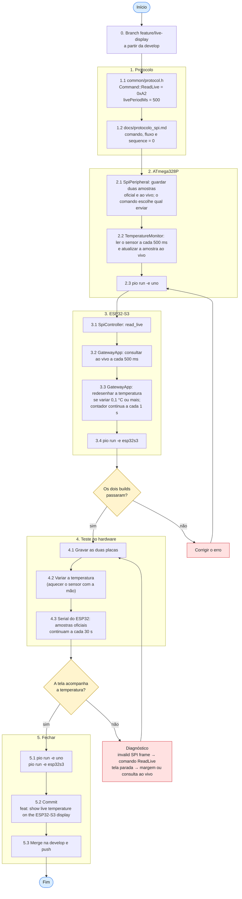

# Tarefa: tela com a temperatura ao vivo

| Campo | Valor |
|---|---|
| Status | Concluída |
| Versão | 3 |
| Branch | `feature/live-display` |

Hoje a tela do ESP32-S3 só muda a cada 30 s, quando chega a amostra oficial. Como a tela será usada na apresentação, ela deve acompanhar a temperatura ao vivo. As amostras de 30 s continuam sendo as únicas publicadas no MQTT, para manter os requisitos 3 e 4 da especificação.

## Decisões

| Decisão | Escolha | Motivo |
|---|---|---|
| Como obter o valor ao vivo | Novo comando SPI `ReadLive` (`0xA2`) | Separa a leitura da tela da amostra oficial; o MQTT continua com o ritmo de 30 s |
| Formato da resposta | O mesmo `SampleFrame`, com `sequence = 0` | Não muda o formato do quadro; a versão do protocolo continua `1` |
| Leitura ao vivo no ATmega | A cada 500 ms | Rápida para a tela, sem sobrecarregar a ISR do SPI |
| Consulta ao vivo no ESP32 | A cada 500 ms | Acompanha a leitura do ATmega |
| Quando redesenhar a temperatura | Variação de pelo menos 0,1 °C em relação ao valor exibido | 1 passo do ADC (≈ 0,098 °C) não atualiza; 2 passos atualizam. Evita piscar com o ruído |
| Contador "Next in N s" | Continua a cada 1 s, baseado nas amostras oficiais | Mostra quando sai a próxima publicação MQTT |

## Histórico

| Versão | Data | Mudança |
|---|---|---|
| 1 | 2026-11-15 | Fluxograma, decisões e checklist iniciais |
| 2 | 2026-11-15 | Passos 1 a 3 concluídos e gravados. Decisões extras: o ATmega zera a transação SPI em qualquer borda do SS (as duas consultas podem vir em sequência); os tempos do ESP32 agrupados em `GatewaySettings` |
| 3 | 2026-11-15 | Concluída: tela acompanhando a temperatura confirmada no hardware |

## Fluxograma

## Checklist

### 0. Branch
- [x] `feature/live-display` criada a partir da `develop`

### 1. Protocolo
- [x] `Command::ReadLive` e `livePeriodMs` em `common/protocol.h`
- [x] `docs/protocolo_spi.md` atualizado no mesmo commit

### 2. ATmega328P
- [x] `SpiPeripheral` com amostra oficial e ao vivo (reset em qualquer borda do SS)
- [x] `TemperatureMonitor` atualizando a amostra ao vivo a cada 500 ms
- [x] `pio run -e uno` passando

### 3. ESP32-S3
- [x] `SpiController::read_live`
- [x] `GatewayApp` consultando ao vivo a cada 500 ms
- [x] Tela redesenhada com variação de 0,1 °C ou mais
- [x] `pio run -e esp32s3` passando

### 4. Hardware
- [x] Firmware gravado nas duas placas
- [x] Tela acompanha a variação de temperatura
- [x] Amostras oficiais continuam a cada 30 s (seq 1 e 2 no serial)

### 5. Fechar
- [x] Builds dos dois ambientes passando
- [x] Commit `feat: show live temperature on the ESP32-S3 display`
- [x] Merge na `develop` e push
